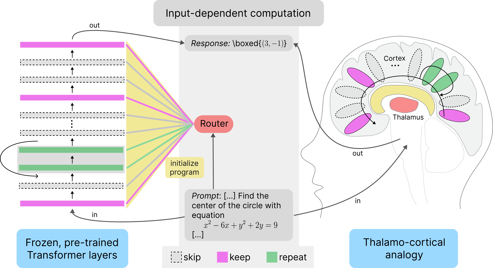
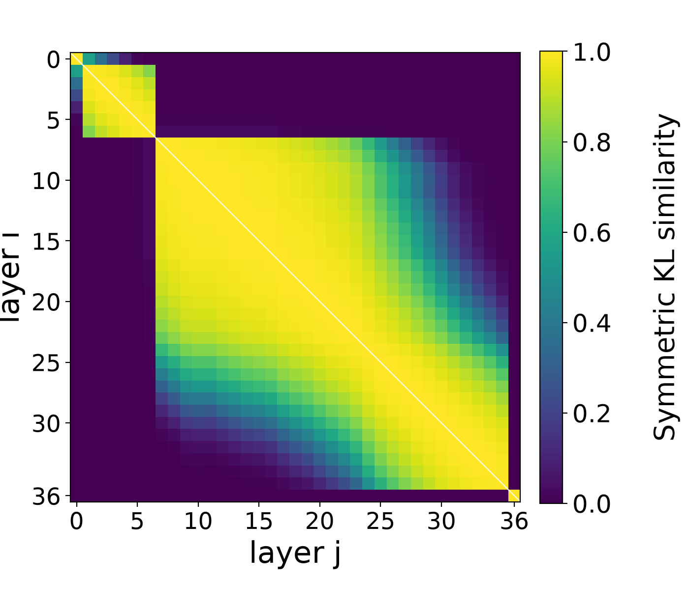
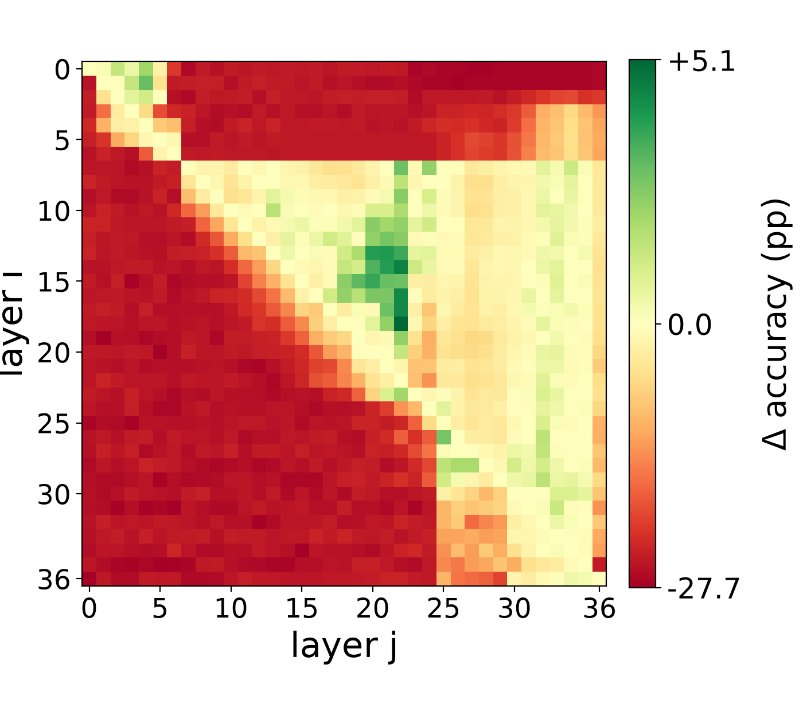
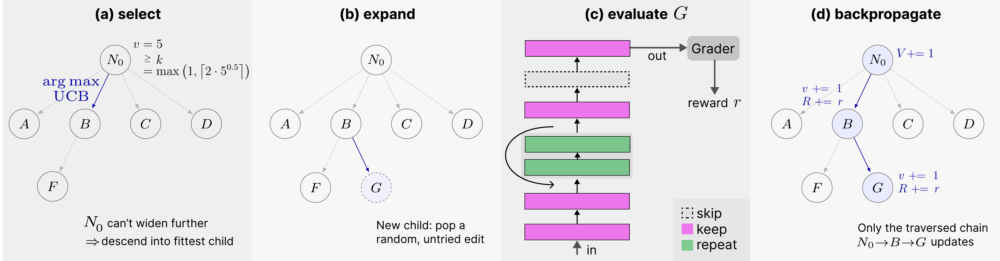
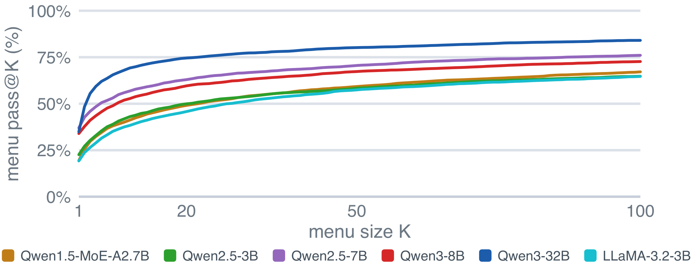

<h1 align="center">RE-PoLar</h1>

<p align="center">Code and data for <em>"Programs-of-Layers in LLMs through the Lens of Cortical Areas"</em> — a reproduction and extension of <a href="https://arxiv.org/abs/2606.06574">PoLar</a> (Li et al., ICML 2026).</p>

<p align="center">[<a href="https://datexis.github.io/RE-PoLar/">Project Page</a>] [<a href="https://arxiv.org/abs/2609.31360">Paper (arXiv)</a>] [<a href="https://huggingface.co/datasets/SWAMBIT/re-polar">Data (Hugging Face)</a>]</p>

> [!NOTE]
> Li et al. released their MCTS code on September 28, 2026
> ([tianyi-lab/PoLar#2](https://github.com/tianyi-lab/PoLar/issues/2)), the same day as our
> [public comment on PoLar's OpenReview page](https://openreview.net/forum?id=pl10b6EQAN);
> their MCTS-derived training programs and router checkpoints are still not released. This
> repository now also runs **their search, their prompt and their data split** (paper Appendix B):
> `--polar-fidelity` reproduces their released search program for program, and
> `re_polar.datasets.polar_split` rebuilds their question sets. All programs, routers and
> results are released (see [Data](#data)).

<p align="center"></p>

LLM inference conventionally runs every input through every transformer
layer, in the same fixed order. [PoLar](https://arxiv.org/abs/2606.06574)
showed a per-input *program-of-layers* that
skips/repeats certain layers, found through a Monte Carlo Tree Search (MCTS), can do better, and
that a small router can predict a good program on out-of-distribution (OOD) data directly, without running the
search at inference time.

This repo reproduces that search and router across 6 models and 3 search seeds, and
releases every program the searches evaluated (56.6M, 4.6M of them valid, i.e. solving their
question) for every question studied. We reproduce several of PoLar's core findings:
skipping beats the standard pass, repeating beats skipping, and combining both beats either alone; shorter programs suffice for
easier questions, while harder ones need more repeats. For PoLar's main claim, the
router's gain, we find what drives it:

- **Under their setup** (their search, prompt and split, run with `--polar-fidelity` on
  `re_polar.datasets.polar_split`), the **router gains by repairing the format of the
  model's answers**, which a single fixed program, selected on validation questions, does
  better, and how much it gains depends strongly on the search seed.
- **In our setup** (a prompt that already fixes the format, a larger data split and our
  search), the **router's top prediction collapses to the standard pass** on every model and
  seed, although its top-5 programs together still gain. The router outputs the decoded
  average of its training labels, under every training recipe we tried (paper Appendix A.9).

Beyond reproduction, a small fixed menu of programs solves far more questions than the
standard pass, and programs that correct errors are brittle: undoing a single edit
typically breaks the correction. We read the router's intended coordinating role as
functionally analogous to how the thalamus routes computation across cortical areas;
a router that actually picks a better program per input remains to be found.

## Motivation

As a prestudy, inspired by David Noel Ng's
[blog post](https://dnhkng.github.io/posts/rys/), we asked whether
rerouting a pretrained LLM's layers at inference time can improve its
accuracy. Both tested on
Qwen3-8B, a 6-domain subset of MMLU-Pro:

<p align="center"> </p>


Layer 6 is a critical boundary in both: a sharp similarity boundary at the
same layer (left/top) matches a collapse in accuracy under repeat/skip when
mixing layers from before and after it (right/bottom). The same holds past
layer 25: layers there are mutually similar (left/top) and tolerate being
skipped (right/bottom), with a well-chosen middle block (layers 18-22) even
net positive under repeat. Reproduced by [`prestudy/`](prestudy/).

## Setup

```bash
python3.12 -m venv .venv && source .venv/bin/activate
pip install -r requirements.txt
```

On Apple Silicon, verify `python3.12` resolves to native arm64:

```bash
python3.12 -c "import platform; print(platform.machine())"  # must print arm64
```

## Method

The method, in three parts:

- **Program**: partitions the model's `D` layers into contiguous segments
  of at most 4 layers, each assigned `keep` (run once), `skip` (remove), or
  `repeat` (run twice). All-`keep` is the identity, the standard forward
  pass. [`re_polar/core/ir.py`](re_polar/core/ir.py)
- **Search**: Per fixed data sample/question, MCTS over edits to the identity program;
  reward is 1 if the resulting program answers correctly, 0 otherwise. UCB
  selection with a length penalty (discourages needlessly long programs)
  plus progressive widening. [`re_polar/mcts/search.py`](re_polar/mcts/search.py),
  [`re_polar/mcts/scheduler.py`](re_polar/mcts/scheduler.py)

  <p align="center"></p>

  One simulation on a toy tree (D=7): selection descends by UCB until it
  reaches a node still under its own widening cap, which is then expanded
  by popping a random untried edit; the resulting program is scored by the
  reward function, and that reward backpropagates up the path just
  traversed, incrementing the visit counter along it. The project page's
  [interactive explorer](https://datexis.github.io/RE-PoLar/) lets you
  step through real search traces in a similar, even more detailed way.

- **Router**: a frozen text embedding model (Qwen3-Embedding-0.6B) encodes
  the input; learnable per-layer query embeddings cross-attend against the
  token representations; a small transformer then lets those per-layer
  queries attend to each other, so each layer's prediction has context
  about the others; two linear heads predict segment boundaries and each
  segment's operation. [`re_polar/router/model.py`](re_polar/router/model.py),
  [`re_polar/router/train.py`](re_polar/router/train.py)

## Data

Everything our searches, routers and fixed programs produced is released as the
Hugging Face dataset [`SWAMBIT/re-polar`](https://huggingface.co/datasets/SWAMBIT/re-polar)
(about 6 GB, documented in [`data/DATA.md`](data/DATA.md)), downloaded into `data/` with
`hf download SWAMBIT/re-polar --repo-type dataset --local-dir data`:

- **Main track** (our DART-Math split, our search, oneshot prompt), 6 models × 3 search
  seeds × 5 difficulty levels: every program each search evaluated, with its verdict
  (`mcts_results/`), the model's generated answer behind each verdict
  (`generated_answers/`), the trained routers (`router_checkpoints/`), their test results
  (`router_results/`), the fixed program per level (`fixed_program/`), and the menu
  cross-execution behind Finding 5, in-sample and held-out (`menu_crossexec/`,
  `menu_crossexec_heldout/`).
- **PoLar split** (`polar_split/`, paper Appendix B): Li et al.'s search on their own
  question sets, 4 models × 2 prompts (`polar_default`, `oneshot`) × 3 seeds, with the
  4-fold router and fixed-program results, the routers trained on their train/val/test
  split, and the out-of-distribution routers.
- **Cross-checks** (`cross_checks/`, Appendix B.4): their search on our split, and our
  search on their split.

No question text or reference answer is stored: the DART-Math questions are rebuilt from
the public DART-Math pool (`re_polar.datasets.dart_math`, `re_polar.datasets.polar_split`)
and joined back by `query_id` (`re_polar.datasets.attach_mcts_questions`).

## Results

The paper reports substantially more results than shown here; this section
is a representative slice. Our
[project page](https://datexis.github.io/RE-PoLar/) also has an
interactive explorer for the MCTS search itself (see Method above).

Skip and repeat combined beat either alone, on every model and DART-Math
difficulty (shown here at difficulty 1, mean ± std over the three search seeds, as in
the paper's appendix table). Base = identity already correct (seed 42);
Skip/Repeat = identity or a skip-only/repeat-only valid program exists;
Skip&Repeat = identity or any valid program exists, all measured over the
MCTS-search pool (all 2000 DART-Math questions per difficulty):

<div align="center">

| model             | Base  | Skip       | Repeat     | Skip&Repeat | Gain  |
| ----------------- | ----- | ---------- | ---------- | ----------- | ----- |
| Qwen1.5-MoE-A2.7B | 22.7% | 35.6 ± 0.7 | 67.0 ± 0.4 | 73.3 ± 0.4  | +50.6 |
| Qwen2.5-3B        | 31.6% | 54.7 ± 0.3 | 75.5 ± 0.8 | 82.3 ± 0.3  | +50.6 |
| Qwen2.5-7B        | 50.0% | 65.2 ± 1.2 | 84.6 ± 0.3 | 89.0 ± 0.2  | +39.1 |
| Qwen3-8B          | 48.6% | 66.7 ± 0.9 | 83.5 ± 0.3 | 88.5 ± 0.4  | +39.9 |
| Qwen3-32B         | 62.5% | 84.6 ± 0.3 | 95.1 ± 0.3 | 97.1 ± 0.2  | +34.6 |
| LLaMA-3.2-3B      | 16.8% | 33.6 ± 0.7 | 59.1 ± 0.8 | 68.7 ± 1.2  | +51.9 |

</div>

Per seed, computed by [`re_polar/mcts/analysis/polar_comparison.py`](re_polar/mcts/analysis/polar_comparison.py)'s
`compute_skip_loop_accuracy`.

<br>

<p align="center"></p>

**Menu coverage** (seed-42 search, oneshot prompt): rank programs by how many questions
they solved during search, then, for each menu size K, execute the top-K of those against
every question and measure what fraction they solve. This ranking includes
the identity/standard-pass program, which is typically the single
highest-coverage entry (it's "valid" for every question the model already
answers correctly with zero layer edits). See
[`analysis/mcts_design/menu_coverage.py`](analysis/mcts_design/menu_coverage.py); the figure
ranks and scores on all 2,000 questions per level (`data/menu_crossexec/`). The held-out check
in the paper ranks on the train+val questions only and scores on the 500 test questions
(`--rank-pool trainval --eval-pool test`, `data/menu_crossexec_heldout/`): averaged over the
6 models and 5 levels, the top-100 menu solves 70.9% against 28.0% for identity (2.5x),
in-sample 71.6% against 27.8% (2.6x). Both are printed by
`python -m analysis.mcts_design.menu_heldout`.
Router accuracy and program-structure analysis are under
[`analysis/`](analysis/); see the paper for the full results.

## Quickstart

Build our DART-Math train/val/test split (MATH+GSM8K, difficulty 1-5), and Li et al.'s
(MATH only, Appendix B):

```bash
python -m re_polar.datasets.dart_math --out-dir ./data/dart_math --include-gsm8k
python -m re_polar.datasets.polar_split --out-dir ./data/polar_split_questions
```

Join question text onto the released MCTS data and train a router:

```bash
python -m re_polar.datasets.attach_mcts_questions \
    --mcts-dir data/mcts_results/qwen3_8b --dart-math-dir ./data/dart_math \
    --out-dir ./data/mcts_results_full/qwen3_8b

python -m re_polar.router.train \
    --samples data/mcts_results_full/qwen3_8b/seed42/dart-math-diff-1/merged_mcts_samples.json \
    --model qwen3_8b --train-per-diff 1250 --out ./results/router_qwen3_8b.pt
```

The released MCTS files hold all 2000 questions of a level in the order
train (1250), val (250), test (500). `--train-per-diff 1250` trains on the
first 1250, validates on the next 250 and leaves the test questions out. The paper's
routers come from the validation-selected sweep in
[`analysis/router_recipe_sweep/sweep_router.py`](analysis/router_recipe_sweep/sweep_router.py)
(learning rate × batch size × epochs, selected by validation loss, Appendix A.9).

Evaluate a trained router against the identity program (the standard forward pass), and
pick and evaluate the fixed program of a level:

```bash
python -m re_polar.router.infer \
    --checkpoint ./results/router_qwen3_8b.pt --model qwen3_8b \
    --data-dir ./data/dart_math --difficulty 1 --top-k-paths 5 \
    --output ./results/infer_qwen3_8b_diff1.json

python -m re_polar.router.fixed_program --model qwen3_8b --difficulty 1 \
    --samples data/mcts_results_full/qwen3_8b/seed42/dart-math-diff-1/merged_mcts_samples.json \
    --data-dir ./data/dart_math --out ./results/fixed_qwen3_8b_diff1.json
```

Both generate an answer for every test question (500 per level): expect hours on a single
GPU, longer on Apple Silicon. Add `--limit 40` (infer) or `--test-limit 40` (fixed
program) for a smoke test.

### Running the MCTS search

[`re_polar/mcts/run_search_dart_math.py`](re_polar/mcts/run_search_dart_math.py) runs one
search per model and level. Its defaults are the paper's main-track configuration (200
simulations, a layer executed at most five times, oneshot prompt, masked-batch + KV
decoding, Appendix A.8), so a main-track run needs no search flags:

```bash
python -m re_polar.mcts.run_search_dart_math --model qwen3_8b --difficulty 1 --split all \
    --seed 42 --data-dir ./data/dart_math \
    --output-root ./data/mcts --cache-dir ./data/mcts_cache
```

`--polar-fidelity` switches to Li et al.'s released search and parameters (100
simulations, a layer executed at most twice, epsilon 0.1, multi-layer edits only at the
root, their per-model program-length window, one shared seed for all questions). The
PoLar-split runs of Appendix B:

```bash
python -m re_polar.mcts.run_search_dart_math --model qwen3_8b --difficulty 1 --split train \
    --polar-fidelity --prompt-style polar_default --seed 42 \
    --data-dir ./data/polar_split_questions/pool \
    --output-root ./data/mcts_polar --cache-dir ./data/mcts_polar_cache
```

Their routers and fixed programs use 4-fold cross-validation over each level's questions:
`python -m re_polar.router.fold_data` writes a fold's train/val/test files for the router
sweep, `router.infer` and `router.fixed_program`. Every run writes `run_config.json` next
to its output. A pilot: add `--n-inputs 20 --budget 20`.

The full release is 6 models × 5 levels × 3 seeds (90 main-track searches) plus 120
PoLar-split searches, each a separate, GPU-hour-scale job: run them in parallel across GPUs
(Appendix C.1 lists the compute we used). The MMLU-Pro search behind Appendix E is
[`re_polar/mcts/run_search_mmlu_pro_domains.py`](re_polar/mcts/run_search_mmlu_pro_domains.py)
(outputs not released).

- `--no-masked-batch` evaluates one program at a time.
- `--masked-batch-max-group-size`: max rows per forward call, uncapped by
  default. Lower it on OOM. Caps that ran for Qwen3-8B:

| Search                  | GPU           | Cap |
| ----------------------- | ------------- | --- |
| DART-Math               | B200 (180 GB) | 768 |
| DART-Math               | A100 (40 GB)  | 512 |
| MMLU-Pro (long prompts) | A100 (40 GB)  | 64  |

## Cluster / Docker

A GPU [`Dockerfile`](Dockerfile) is included (CUDA 12.8, prebuilt
flash-attention wheel) for running the pipeline above on a cluster instead
of locally — see the file's own header comments for why the `-devel` base
image and that particular wheel were chosen. Building it locally on
**Apple Silicon Docker Desktop** may fail `apt-get update` with a GPG
signature error under `--platform linux/amd64` emulation — that's a Docker
Desktop/QEMU quirk on this platform, not a Dockerfile or registry problem;
it builds cleanly on a real Linux host (verified on cluster).

## Citation

```bibtex
@article{westerhoff2026repolar,
      title={Programs-of-Layers in LLMs through the Lens of Cortical Areas},
      author={Westerhoff, Justus and Olbrich, Stephan and Oraby, Hatem and Senn, Walter and Larkum, Matthew Evan and Gers, Felix Alexander},
      journal={arXiv preprint arXiv:2609.31360},
      year={2026}
}
```

Machine-readable version: [`CITATION.cff`](CITATION.cff).

## License

[MIT](LICENSE). Third-party data/code this project depends on is listed in
[`NOTICE.md`](NOTICE.md).
